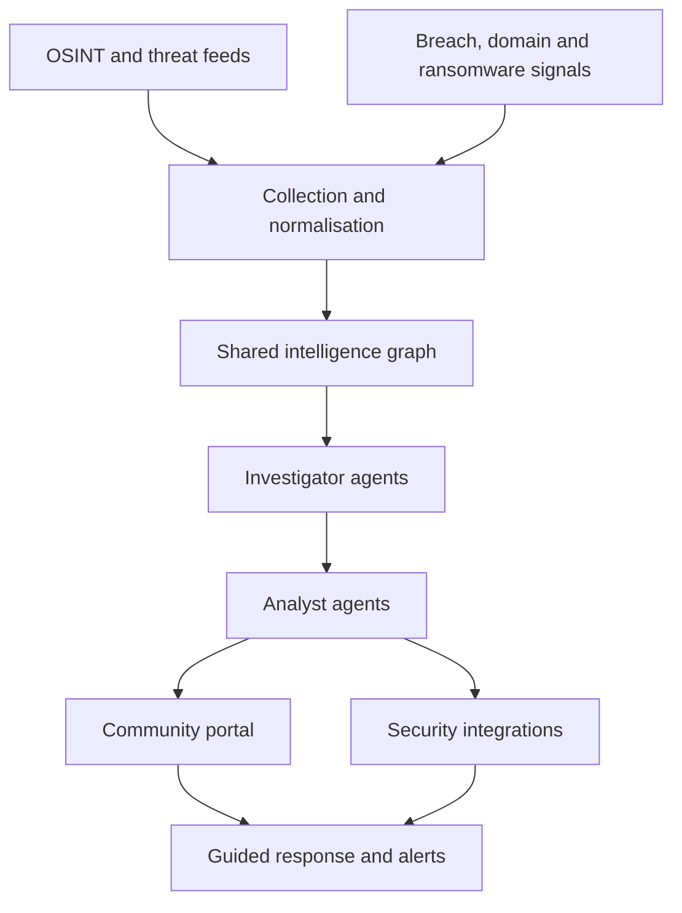

# Community CTI

A community-first, AI-assisted cyber threat intelligence platform for organisations without a security team.

## Vision

Build an affordable, AI-assisted cyber threat intelligence service that helps organisations discover threats, understand their relevance and respond, without needing dedicated security analysts or an enterprise security budget.

**Positioning:** democratising threat intelligence, not merely building a cheaper version of Flare.

## Who it is for

The initial focus is Aboriginal Community Controlled Organisations (ACCOs), Land Councils, Aboriginal Medical Services, Indigenous corporations and other under-resourced organisations across Australia. Participating organisations are co-design partners, not just customers. The platform is intended to complement the ACSC's resources for First Nations businesses, not replace them.

## Product experience

An organisation signs up, verifies its domains, gives its name and can optionally connect Microsoft 365. The service then helps identify:

- Employee credentials exposed in known breaches or lawfully sourced credential datasets
- Lookalike domains that may be impersonating the organisation
- Relevant ransomware or cybercrime reporting
- Publicly exposed infrastructure with known vulnerabilities
- Phishing campaigns impersonating its services
- The threats most relevant to its actual operations, explained in plain English

The product investigates, correlates, prioritises and supports action. It does not just display raw indicators and feeds. Every finding shows its provenance, a confidence score and a way to dismiss or challenge it.

## Core capabilities

| Capability | Approach |
|---|---|
| Intelligence collection | Deterministic collectors for public and legitimately accessible sources, plus specialised enrichment workers |
| Entity discovery | Map organisations to verified domains, brands, assets and infrastructure |
| Threat correlation | Connect indicators, campaigns, vulnerabilities, identities and exposures |
| Investigation | AI-assisted evidence gathering and confidence assessment |
| Reporting | Plain-English, organisation-specific summaries and recommendations |
| Response | Guided remediation and approved integrations and workflows |

## Architecture



Conventional software handles ingestion and validation. AI is used only where it adds measurable value, and consequential remediation always needs human approval. See [docs/ARCHITECTURE.md](docs/ARCHITECTURE.md) and the [ADRs](docs/adr/).

## Principles

- **Organisational control:** each organisation owns its data and decides what happens to it.
- **Opt-in, granular sharing:** nothing is shared with the community network unless the organisation chooses to, item by item.
- **Cultural data is protected:** it is never shared automatically and never used to train models.
- **Australian data residency:** data stays in Australia, and any exception is documented.
- **Accessibility:** plain English, low-bandwidth friendly, usable without security expertise.
- **Co-design:** features that affect communities are designed with them.

See [docs/DATA-GOVERNANCE.md](docs/DATA-GOVERNANCE.md) for CARE principles and Maiam nayri Wingara alignment.

## Phased plan

Milestones are planning targets, not guaranteed delivery dates.

**Phase 1, days 1 to 30: Foundation.** Onboarding and domain verification, public feed ingestion, domain impersonation monitoring, organisation-specific matching, plain-English alerts and a basic dashboard, provenance, confidence and evidence links.
*Exit:* a pilot organisation verifies its assets and receives a useful, explainable finding.

**Phase 2, days 31 to 60: Investigation and Response.** AI-assisted investigation, Microsoft 365 integration, asset and vulnerability correlation, legally sourced credential exposure, approval-based remediation, false-positive feedback and analyst review.
*Exit:* a user can understand and appropriately respond to a validated threat with minimal specialist help.

**Phase 3, days 61 to 90: Community Pilot.** Pilot with three to five consenting organisations, measure precision, false positives, investigation cost and time to action, add opt-in sanitised community sharing, refine onboarding and accessibility, establish sustainable costs.
*Exit:* demonstrated value, trusted alerts and a viable path to sustainable operation.

**Later.** Underground collection and stealer-log acquisition are deferred and blocked until lawful access, security controls and operating procedures exist.

## Illustrative commercial model (hypotheses only)

> **These prices are hypotheses, not validated unit economics.** They will change after the pilot.

| Tier | Hypothetical price | Intended audience |
|---|---:|---|
| Community | Free | Eligible small Indigenous organisations |
| Community Plus | A$29/month | Smaller organisations needing integrations |
| Business | A$99/month | Australian SMBs |
| Managed Intelligence | A$299+/month | Organisations needing hands-on support |

Fair-use limits and cost controls apply. Sponsorship from larger businesses, councils and government may subsidise community access, but sponsors never get access to participating organisations' private intelligence.

## Key risks

- **Source access:** AI cannot replace reliable, lawful, high-quality collection sources.
- **Privacy and consent:** credential and identity exposure data needs especially careful handling.
- **Legal and contractual compliance:** respect collection restrictions, licences, privacy obligations and platform terms.
- **False positives:** every material finding needs provenance, confidence and a way to challenge or dismiss it.
- **Multi-tenant security:** prevent intelligence and sensitive metadata leaking between organisations.
- **Model security:** ingested source material is untrusted and agents must resist prompt injection.
- **Cost:** bound inference, enrichment, crawling, storage and human review costs.
- **Community trust:** co-design governance and consent before launching sharing features.

## Success metric

> Can an organisation with no dedicated cyber security staff discover a genuine threat, understand it and take an appropriate action in under ten minutes?

Supporting measures: alert precision, time to triage, time to remediation, percentage of findings acted on, cost per monitored organisation and user confidence.

## Strategic direction

Option 3, delivered incrementally: a credible, reusable intelligence engine beneath an accessible community-facing product. Start with the community use case, validate outcomes and deepen collection only where it demonstrably improves coverage and accuracy.

## Repository layout

```
apps/api            HTTP API (tenant-scoped)
apps/portal         Community portal (placeholder)
packages/schema     Finding, provenance and confidence model
packages/collectors Deterministic collector contracts
docs/               Architecture, governance, sources, threat model, ADRs, CI templates
```

## Getting started

```bash
corepack enable
pnpm install
pnpm build
pnpm test
```

CI templates live in [docs/ci/](docs/ci/) until they can be moved into `.github/workflows/`.

## Roadmap

See the pinned roadmap issue and the milestones.

## Licence

Apache-2.0. See [LICENSE](LICENSE) and [ADR 0002](docs/adr/0002-licence.md).
