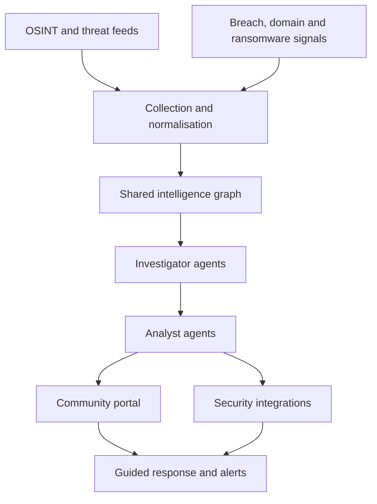

# Architecture

## Overview

## Layers

### Collection layer
Deterministic collectors (`packages/collectors`) ingest OSINT, licensed feeds, breach signals, ransomware reporting and domain intelligence. Every record keeps provenance: source id (from [SOURCES.md](SOURCES.md)), source terms, collection timestamp, confidence and access restriction (TLP). Collectors never call a language model.

### Intelligence graph
STIX 2.1 objects ([ADR 0004](adr/0004-stix-2-1-data-model.md)) stored in PostgreSQL, with OpenSearch for full-text and indicator search and S3-compatible object storage for raw evidence. Whether OpenCTI or MISP sits underneath is an open decision ([ADR 0001](adr/0001-opencti-vs-misp-vs-custom.md)).

### Agent layer ([ADR 0006](adr/0006-agent-boundaries.md))
- **Collector agents:** coordinate ingestion, extraction, normalisation and deduplication. Mostly conventional code.
- **Investigator agents:** correlate indicators and verify supporting evidence. Read-only tools. Output is a proposed finding with evidence and confidence.
- **Analyst agents:** prioritise, explain relevance in plain English and draft remediation. Cannot act; any consequential action needs human approval.

### Portal and integrations
A multi-tenant portal and API (`apps/api`, `apps/portal`), webhooks, Microsoft 365 and SIEM integrations.

## Tenancy and security
- Every tenant-owned table has `tenant_id` and PostgreSQL row-level security. The API sets `app.tenant_id` per request.
- OpenSearch uses per-tenant index aliases with filtered queries.
- Audit log of every read of sensitive data and every state change.
- Encryption in transit and at rest; credential exposure data is field-encrypted.
- Source-level access controls: a TLP:AMBER source is never shown to tenants outside its licence terms.
- Retention policies from day one (see [DATA-GOVERNANCE.md](DATA-GOVERNANCE.md)).

## Findings

A finding (`packages/schema/src/index.ts`) must have at least one provenance record, an integer confidence from 0 to 100, and a status that supports `dismissed` and `challenged`.

Confidence bands (initial, to be calibrated in the pilot):

| Band | Range | Meaning |
|---|---|---|
| Low | 0 to 39 | Weak or single unverified signal |
| Medium | 40 to 69 | Corroborated by one independent source or strong heuristic |
| High | 70 to 100 | Directly verified against the organisation's verified assets |

## Core tables (initial)

| Table | Purpose |
|---|---|
| `tenants` | Organisations |
| `users`, `memberships` | People and roles per tenant |
| `verified_domains` | Domains with verification method and timestamp |
| `sources` | Mirrors SOURCES.md: licence, terms, TLP, cost |
| `observations` | Raw normalised records with provenance |
| `stix_objects` | STIX 2.1 objects (jsonb) with `tenant_id` nullable for shared intelligence |
| `findings` | Tenant-scoped findings |
| `finding_evidence` | Links findings to observations and evidence keys |
| `finding_feedback` | Dismiss, challenge and comments |
| `actions` | Proposed and approved remediation |
| `audit_log` | Append-only audit trail |
